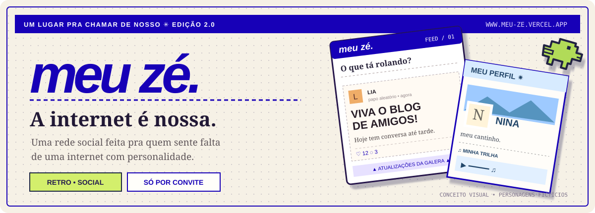
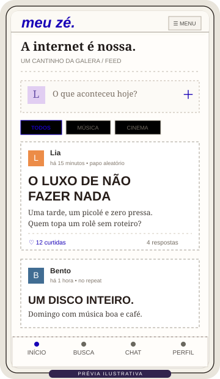
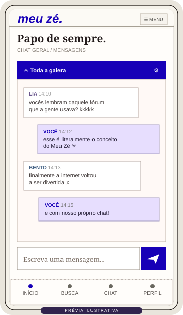
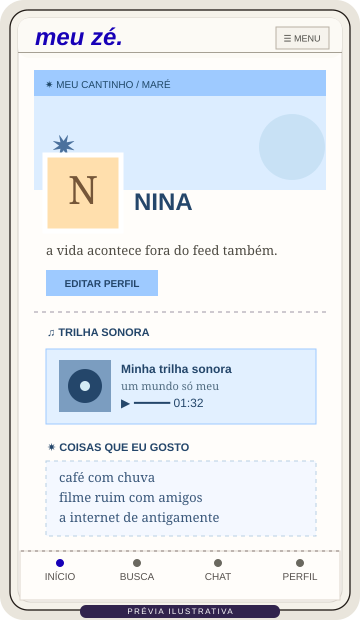
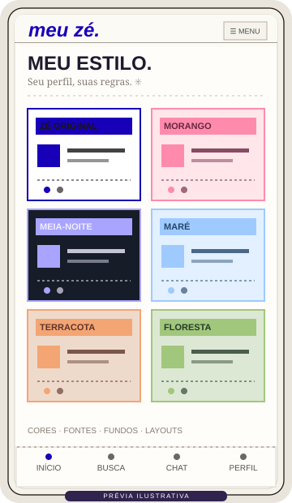

<p align="center">
  
</p>

<h1 align="center">🦕 Meu Zé 2.0</h1>

<p align="center">
  <strong>A internet é nossa.</strong><br/>
  Uma rede social retrô para um grupo de amigos — com feed, perfis que têm personalidade e um chat que parece ter vindo da época boa da internet.
</p>

<p align="center">
  <a href="https://meu-ze.vercel.app/"></a>
  <a href="https://github.com/Yoshiizin/meu-ze/actions/workflows/android-apk.yml"></a>
</p>

<p align="center">
  
  
  
  
  
</p>

<p align="center">
  <a href="#-conheça-o-meu-zé">Conheça</a> ·
  <a href="#-a-interface">Telas</a> ·
  <a href="#-instale-no-seu-celular">Instalação</a> ·
  <a href="#-para-desenvolvedores">Código</a> ·
  <a href="https://github.com/Yoshiizin/meu-ze/issues">Sugestões e bugs</a>
</p>

---

## ✳️ Conheça o Meu Zé

**Já pensou em ter uma rede social só da sua galera?**

O Meu Zé é uma experiência social inspirada no espírito dos blogs pessoais, Orkut, MSN e perfis cheios de personalidade. Aqui, cada um pode montar o próprio cantinho, conversar, postar, ouvir música e deixar a rede com a sua cara.

A interface mistura **tipografia marcante, detalhes retrô, divisórias pontilhadas e muita personalização**. O projeto é pensado primeiro para celular, com versão web instalável e app Android.

> 🔒 **Por convite:** o código deste projeto é público para apresentar o desenvolvimento. Isso **não** significa que qualquer pessoa possa ingressar na rede: as contas seguem o fluxo de autenticação e convite configurado no aplicativo. Não publicamos códigos de convite, conversas reais ou dados dos participantes neste README.

## 📸 A interface

<p align="center">
  
  
  
  
</p>

<p align="center"><em>Prévias ilustrativas inspiradas nas telas e nos estilos do projeto. Nomes, mensagens e publicações são fictícios — não são prints de contas ou conversas reais.</em></p>

<table>
  <tr>
    <td width="50%" valign="top">
      <h3>📝 Feed da galera</h3>
      <p>Postagens com texto, mídia, reações, comentários, tópicos e atualização ao puxar para baixo no celular.</p>
    </td>
    <td width="50%" valign="top">
      <h3>💬 Conversas retrô</h3>
      <p>Chat geral e privado com estética inspirada em mensageiros clássicos, mídia, efeitos sonoros e preferências de notificação.</p>
    </td>
  </tr>
  <tr>
    <td valign="top">
      <h3>🎨 Perfil com personalidade</h3>
      <p>Avatar, capa, cores, tipografia, papel de parede, elementos pessoais e trilha sonora do perfil.</p>
    </td>
    <td valign="top">
      <h3>✷ Temas e customização</h3>
      <p>Presets como Zé Original, Morango, Meia-noite, Maré, Terracota e Floresta; estilos específicos para o chat.</p>
    </td>
  </tr>
</table>

## 🚀 Destaques da edição 2.0

- **Personalização:** monte um perfil que realmente pareça seu, em vez de usar o mesmo modelo para todo mundo.
- **Rede social fechada:** contas e convites para os membros autorizados.
- **Chat geral e privado:** texto, envio de mídias e personalização do visual do chat.
- **Áudios e notificações:** sons configuráveis e suporte a notificações push no Android, quando a infraestrutura está configurada e as permissões são concedidas.
- **Feed de posts:** publicações, curtidas, comentários e mídia em múltiplos formatos.
- **Experiência mobile:** interface responsiva, PWA e opção de app Android com WebView.
- **Links clicáveis:** links em publicações e mensagens abrem seus destinos.

## 📲 Instale no seu celular

<table>
  <tr>
    <th>Android</th>
    <th>iPhone / iPad</th>
    <th>Navegador</th>
  </tr>
  <tr>
    <td>
      <a href="https://github.com/Yoshiizin/meu-ze/actions/workflows/android-apk.yml"><strong>⬇ Baixar Meu-Ze.apk 2.0</strong></a><br/>
      <sub>Android 10+ · APK em Artifacts</sub>
    </td>
    <td>
      Abra <a href="https://meu-ze.vercel.app/">meu-ze.vercel.app</a> no Safari e toque em <strong>Compartilhar → Adicionar à Tela de Início</strong>.
    </td>
    <td>
      <a href="https://meu-ze.vercel.app/"><strong>Acessar Meu Zé na web ↗</strong></a><br/>
      <sub>Conta e convite necessários para participar</sub>
    </td>
  </tr>
</table>

**Android:** baixe o ZIP do APK no [build mais recente do GitHub Actions](https://github.com/Yoshiizin/meu-ze/actions/workflows/android-apk.yml), extraia o arquivo APK, autorize a instalação pelo sistema quando solicitado e entre com sua conta. Para alertas em segundo plano, permita notificações no Android e ajuste suas preferências no chat. A versão publicada foi assinada para testes; atualizações com outro certificado podem exigir reinstalação.

> ⚠️ O aplicativo Android é uma WebView que abre o site do Meu Zé e precisa de internet para feed e mensagens. A versão iOS é um PWA pelo Safari, não um aplicativo nativo da App Store.

## 🏗️ Para desenvolvedores

```text
meu-ze/
├── meu-ze-online/
│   ├── app/                 # Interface Next.js, feed, perfis, chat e APIs
│   ├── public/              # Ícones, PWA, service worker e áudio
│   ├── lib/                 # Integração de cliente com Supabase
│   └── supabase/            # Scripts de banco e políticas
├── android/
│   ├── app/                 # WebView Android e notificações Firebase
│   └── PUSH-SETUP.md       # Configuração de mensagens push
├── docs/showcase/           # Material público de apresentação
└── .github/workflows/       # Build automatizado de APK
```

**Tecnologias:** Next.js 16 · React 19 · TypeScript · Supabase (auth, Postgres e storage) · Vercel · PWA · Android WebView · Firebase Cloud Messaging.

Para executar localmente o site:

```bash
cd meu-ze-online
npm install
npm run dev
```

A aplicação requer **Node.js 22.13+** e configuração válida do Supabase. Consulte a [documentação web](./meu-ze-online/README.md), a [documentação Android](./android/README.md) e a [configuração de push](./android/PUSH-SETUP.md). O [workflow de APK](https://github.com/Yoshiizin/meu-ze/actions/workflows/android-apk.yml) compila a edição Android.

### 🔐 Segurança e privacidade

O repositório apresenta apenas o código. **Não copie segredos para ele.** Credenciais administrativas, tokens de serviço do Firebase, chaves `SUPABASE_SERVICE_ROLE_KEY`, arquivos `.env.local`, senhas e convites reais não devem ser enviados ao GitHub.

Os valores públicos de configuração de cliente, como `NEXT_PUBLIC_SUPABASE_URL` e a chave **anon/public** do Supabase, **não** substituem validações e políticas RLS. Mídias em armazenamento público podem ser acessadas por quem recebe o endereço do arquivo. Mantenha políticas de acesso e regras do backend revisadas antes de convidar mais pessoas.

### ⚖️ Licença e direitos

As partes originais deste projeto são disponibilizadas sob a **[Licença MIT](./LICENSE)**, que permite reutilização, modificação e distribuição, inclusive comercial, com preservação do aviso de copyright. Bibliotecas externas continuam sujeitas às próprias licenças. A MIT não autoriza reutilizar mensagens, músicas, fotos ou outros conteúdos dos membros, nem concede direitos sobre marcas. Consulte os [avisos de terceiros e mídia](./THIRD_PARTY_NOTICES.md).

**Nota sobre downloads antigos:** uma release Android 2.0 anterior foi gerada antes da revisão de direitos dos áudios. Os links principais agora direcionam à compilação atualizada; releases anteriores precisam de revisão antes de redistribuição.

### 🧩 Contribua

Sugestões de interfaces, melhorias de acessibilidade, relatos de erro e ideias para customização são bem-vindos. Veja [CONTRIBUTING.md](./CONTRIBUTING.md) e abra uma [Issue](https://github.com/Yoshiizin/meu-ze/issues).

**Status:** edição web disponível, Release Android 2.0 publicada e builds no GitHub. A experiência deve ser validada nos dispositivos reais; presença do código ou build bem-sucedido não garante todas as funções em todas as versões de Android.

---

<p align="center">
  <strong>🦕 meu zé.</strong><br/>
  <em>Uma rede pequena o suficiente pra ser nossa — e diferente o suficiente pra ter personalidade.</em>
</p>
<p align="center"><sub>Projeto independente de rede social retrô. Sem vínculo com Orkut, MSN ou PI.FYI.</sub></p>
